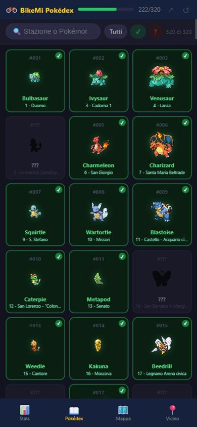
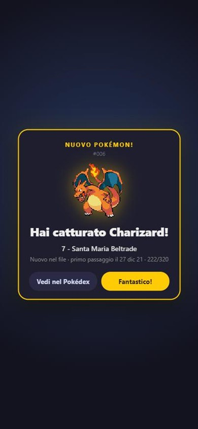
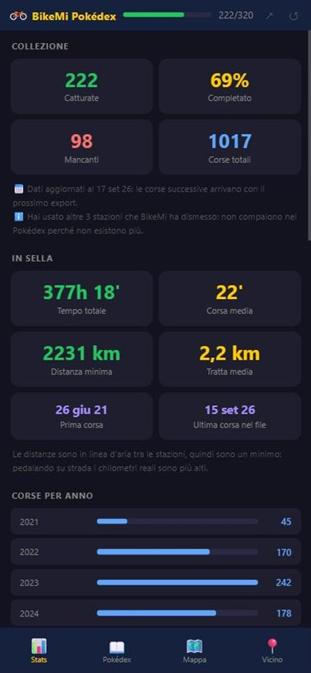
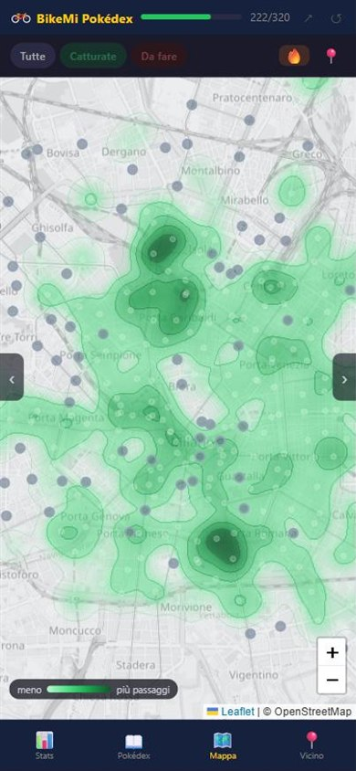

# 🚲 BikeMi Pokédex

**Trasforma le tue corse [BikeMi](https://www.bikemi.it) in un Pokédex.** Ogni stazione del bike sharing di Milano nasconde un Pokémon: quelle dove hai preso o lasciato una bici risultano catturate, le altre restano silhouette da scoprire.

### 👉 [Apri l'app](https://IL-TUO-SITO.netlify.app)

<!-- Sostituisci il link qui sopra con l'indirizzo Netlify dell'app. -->

Funziona dal browser del telefono e si installa sulla schermata Home come una normale app. Non serve registrarsi e non c'è un server: il file che carichi viene letto sul tuo dispositivo e non lascia il telefono.

<p align="center">
  
  
  
  
</p>

---

## Cos'è

Un gioco costruito sui tuoi dati di BikeMi. Carichi lo storico delle corse e l'app:

- associa a ognuna delle circa 320 stazioni un Pokémon delle prime tre generazioni, con i 21 leggendari nelle stazioni più sperdute (Mewtwo è a Molino Dorino)
- segna come catturate le stazioni dove sei passato, a colori, e lascia le altre in silhouette con nome "???"
- ti mostra statistiche, una mappa con heatmap delle zone dove pedali di più e le stazioni da catturare più vicine a te
- con l'app aperta, ti fa catturare col GPS una stazione nuova appena ci arrivi, senza aspettare il prossimo export

## Il file da caricare

BikeMi, come richiede il GDPR, permette di scaricare tutti i dati che conserva su di te. Si ottiene uno **zip** con alcuni file JSON:

| File | Cosa contiene | L'app lo usa? |
|---|---|---|
| `trips.json` | Ogni corsa: stazione di partenza e di arrivo, con coordinate, data, ora e durata | **Sì, è l'unico** |
| `orders.json` | Pagamenti e rinnovi dell'abbonamento | No |
| `subscriptions.json` | Abbonamenti attivati | No |
| `penalties.json` | Eventuali penali | No |
| `personal-information.json` | I dati del tuo profilo | No |

Per scaricarlo: accedi su [bikemi.it](https://www.bikemi.it) → **Account** → **Scarica i tuoi dati**. Puoi caricare nell'app lo zip così com'è oppure solo il `trips.json` estratto. Dello zip viene aperto solo `trips.json` e gli altri file non vengono nemmeno letti.

L'export è una fotografia del momento in cui lo scarichi. Per aggiornare il Pokédex con le corse nuove scarichi un export nuovo e lo ricarichi col pulsante ↺: le corse precedenti non vanno conservate.

## Come si usa

1. Scarica l'export da BikeMi (vedi sopra) e salvalo sul telefono.
2. Apri l'app dal telefono e installala sulla schermata Home: su iPhone da Safari, su Android da Chrome. I passaggi sono in [iPhone e Android](#iphone-e-android).
3. Apri l'app dall'icona appena creata e carica lo zip o il `trips.json`.
4. Guarda le Poké Ball scoprire le tue catture, poi esplora le quattro schede.
5. Quando hai fatto qualche giro nuovo, scarica un export aggiornato e ricaricalo col pulsante ↺ in alto a destra: le stazioni nuove si aprono una per una.

| Scheda | Contenuto |
|---|---|
| **Stats** | Ore in sella e distanza, corse per anno, a che ora e in che giorni pedali, record personali, completamento per generazione, stazioni preferite |
| **Pokédex** | Tutte le stazioni con ricerca e filtro catturate / mancanti |
| **Mappa** | Milano con le stazioni, filtri e la tua posizione; ogni stazione apre Google Maps per andarci in bici. Col pulsante 🔥 diventa una heatmap delle zone dove pedali di più |
| **Vicino** | Le stazioni da catturare più vicine a te, con distanza e minuti a piedi, e una tratta proposta da aprire in Google Maps |

Si cambia scheda dalla barra in basso o scorrendo col dito. Sulla mappa lo scorrimento sposta la mappa, quindi lì ci sono due frecce ai bordi.

I dati restano salvati sul dispositivo: alla riapertura ritrovi la tua collezione senza ricaricare nulla.

## iPhone e Android

L'app è la stessa, ma i due sistemi trattano diversamente le web app.

| | iPhone | Android |
|---|---|---|
| **Browser per installarla** | Safari | Chrome (o Samsung Internet, Edge) |
| **Come si installa** | Condividi (il quadrato con la freccia) → *Aggiungi alla schermata Home*. L'app lo spiega con un avviso in basso | Pulsante *Installa* nell'avviso in basso, oppure menu ⋮ → *Aggiungi alla schermata Home* |
| **Dove trovi l'export da caricare** | App File, di solito in *Download* | Cartella *Download* |
| **Dati caricati** | L'app sulla Home ha un archivio **separato** da Safari: carica il file dopo averla installata, dentro l'app | Condivisi con Chrome: se hai caricato il file nel browser, l'app installata li ritrova |
| **Permesso di posizione** | Può essere richiesto di nuovo dopo qualche giorno. Invece del popup compare il pulsante *Attiva la cattura GPS*; per evitarlo, vedi sotto | Concesso una volta, resta |
| **App in secondo piano** | iOS la sospende da solo; al ritorno il GPS riparte | Il GPS si spegne per non consumare batteria e riparte quando torni nell'app |
| **Vibrazione alla cattura** | No, Safari non la supporta | Sì |
| **Aggiornamenti** | Apri l'app due volte: la prima scarica la versione nuova, la seconda la mostra | Uguale |

Funzionano allo stesso modo su entrambi: caricamento del file, Pokédex, statistiche, mappa, heatmap, cattura col GPS e Google Maps per navigare fino a una stazione.

**Su iPhone usa l'app dalla Home, non solo da Safari.** Safari cancella i dati salvati dai siti che non apri per sette giorni di utilizzo del browser; le app aggiunte alla Home sono escluse da questa pulizia. Lo stesso vale per le catture col GPS.

**Su iPhone, da Chrome o Firefox:** l'aggiunta alla Home funziona in modo diverso e non sempre c'è, quindi l'app ti chiede di aprire il link in Safari. Su iPad vale tutto quello che vale per iPhone.

**Per non vedere più la richiesta di posizione su iPhone** concedila in modo permanente: Impostazioni › Privacy e sicurezza › Localizzazione › Siti web di Safari › *Mentre usi l'app*, oppure in Safari dal menu **aA** › Impostazioni sito web › Posizione › *Consenti*. I nomi delle voci possono variare con la versione di iOS.

## Funzioni nel dettaglio

<details>
<summary><b>Il lancio delle Poké Ball</b></summary>

A ogni caricamento le schede catturate partono coperte e alcune Poké Ball ne scoprono qualcuna a caso nella prima schermata. Il Pokédex scorre e lo stesso succede nelle tre schermate successive, poi tutte le altre si scoprono insieme e si torna in cima. Dura circa 7 secondi, e la durata dipende dalle schermate, non da quante catture hai: è la stessa con 20 Pokémon e con 300.

Quando ricarichi un export più recente, l'app confronta le catture con quelle di prima. Se i Pokémon nuovi sono fino a 15, per ognuno arriva una Poké Ball e si apre la sua scheda, con *Avanti* per passare al successivo e *Salta gli altri* per chiudere. Se sono di più, niente schede una per una: parte il lancio normale, che scopre per primi i nuovi. In entrambi i casi l'avviso finale dice quanti sono, per esempio "3 nuovi Pokémon".
</details>

<details>
<summary><b>Chi è? I nomi nascosti</b></summary>

Come nel Pokédex vero, finché non catturi una stazione non sai quale Pokémon ti aspetta: al posto di nome e numero compare "???", anche nella lista Vicino, nei popup della mappa e nella tratta proposta. Il nome della stazione resta visibile. Restano due indizi, la silhouette e la stella dorata dei leggendari. La ricerca per nome trova solo i Pokémon già catturati, altrimenti svelerebbe gli altri.
</details>

<details>
<summary><b>Leggendari</b></summary>

I 21 Pokémon leggendari fino alla terza generazione — Mewtwo, Mew, Lugia, Ho-Oh, Rayquaza e gli altri — sono assegnati alle 21 stazioni più lontane dal Duomo, in ordine di distanza: Mewtwo alla più remota. Oggi sono quelle oltre i 4,9 km circa, a partire da Molino Dorino e Cascina Merlata. Hanno il bordo dorato anche da non catturati e una riga dedicata nelle statistiche.

Chi aveva già l'app installata riceve uno scambio una tantum invece di un rimescolamento: ogni stazione lontana prende il suo leggendario e chi lo aveva prende il numero rimasto libero. Le catture restano tutte, perché sono legate alla stazione e non al Pokémon.
</details>

<details>
<summary><b>Heatmap</b></summary>

Il pulsante 🔥 sulla mappa colora la città in base ai tuoi passaggi, partenze e arrivi insieme: verde chiaro dove sei passato poco, verde scuro dove passi più spesso. Il colore è sfumato ma diviso in cinque fasce, separate da linee sottili come le curve di livello di una carta topografica. Intanto la mappa sotto diventa grigio chiaro e semitrasparente, perché sul fondo scuro il verde scuro non si vedrebbe. Le stazioni catturate diventano quasi trasparenti, perché il verde lo dà già la heatmap, mentre quelle da fare restano grigie e ben visibili. La scelta resta salvata.

Il calcolo è leggero e avviene sul telefono. Ogni stazione pesa la radice quadrata dei suoi passaggi, così la stazione sotto casa non oscura tutte le altre. Le macchie, di circa mezzo chilometro a qualsiasi zoom, si sommano: due stazioni vicine fanno una zona più intensa. Il verde più scuro va sempre al punto più frequentato fra quelli inquadrati.
</details>

<details>
<summary><b>Cattura col GPS</b></summary>

Con l'app aperta e il permesso di posizione concesso, non serve riesportare i dati per spuntare una stazione nuova: basta arrivarci.

- Entro 250 metri da una stazione non ancora catturata compare in basso una Poké Ball che oscilla, sempre più in fretta man mano che ti avvicini
- Entro 40 metri parte la cattura: la Poké Ball cade, oscilla tre volte, scatta, e si apre la scheda del Pokémon
- Se il GPS è impreciso, oltre i 60 metri di incertezza, la cattura non scatta: meglio aspettare che segnare una stazione dove non sei

Essere vicino a una stazione non prova di averci lasciato la bici, quindi le catture GPS restano distinte da quelle registrate: badge blu nel Pokédex e "Catturata col GPS" nel dettaglio. Al caricamento di un nuovo export **vince il file**: le catture GPS che il file conferma diventano catture normali, tutte le altre spariscono. Per lo stesso motivo conviene caricare sempre un export appena scaricato: uno più vecchio di una cattura GPS la cancellerebbe, perché non può conoscerla.

Una web app non può leggere la posizione a schermo spento, quindi tutto questo funziona solo con l'app aperta.
</details>

<details>
<summary><b>Permesso di posizione, anche su iPhone</b></summary>

Il permesso viene chiesto una volta sola: le aperture successive lo riusano senza domandare nulla. Se lo revochi dalle impostazioni, l'app se ne accorge e smette di riprovare.

All'avvio il GPS parte da solo solo se il telefono conferma che il permesso è già concesso. Su iPhone l'app aggiunta alla schermata Home può dimenticare il permesso tra un'apertura e l'altra, e dall'app non c'è modo di impedirlo. In quel caso, invece di un popup a sorpresa a ogni avvio, compare un pulsante "Attiva la cattura GPS" e il popup arriva solo toccandolo. Sempre su iPhone il GPS non viene spento quando l'app passa in secondo piano, perché iOS sospende già da solo le app in background. Altrove si ferma, per non consumare batteria.
</details>

<details>
<summary><b>L'invito a installarla</b></summary>

Dopo il caricamento appare in basso un invito a installare l'app, che si chiude e non torna più. Il testo cambia col dispositivo: pulsante *Installa* su Android, i passaggi Condividi → *Aggiungi alla schermata Home* su iPhone, il rimando a Safari per chi su iPhone usa Chrome, Firefox o Edge. L'iPad da iPadOS 13 si presenta come un Mac desktop: si distingue da un Mac vero solo perché ha un touch screen, e l'app controlla proprio quello.
</details>

<details>
<summary><b>La tratta proposta</b></summary>

La tratta della scheda Vicino è una sola corsa fra due stazioni, non un giro a tappe: con BikeMi la bici si lascia in stazione, quindi un percorso con più fermate vorrebbe dire noleggiarla da capo ogni volta. Si parte dalla stazione più vicina a te e si arriva a una da catturare a circa 2, 4 o 6 km.
</details>

## Cosa i dati non dicono

L'export di BikeMi è più povero di quanto sembri, e l'app preferisce dichiararlo piuttosto che stimare.

**Le distanze sono in linea d'aria.** Ogni corsa riporta solo stazione di partenza e di arrivo, non il tragitto, quindi la distanza è calcolata tra le due coordinate. I chilometri reali sono di più, perché le strade non vanno dritte: per questo il totale è etichettato come "distanza minima". Solo per la tratta più lunga il percorso ciclabile vero viene chiesto al servizio Valhalla di [FOSSGIS](https://valhalla1.openstreetmap.de), basato su OpenStreetMap e senza chiavi API. Se non risponde entro quattro secondi, la tratta viene stimata come linea d'aria × 1,1 e mostrata col segno `≈`.

**Il tipo di bici non c'è.** Nessun file dell'export distingue la bici normale dall'elettrica, quindi una statistica sull'elettrica non è ricavabile.

**Le corse senza riconsegna risultano senza arrivo.** Se una bici non torna in stazione la corsa non ha arrivo: non conta nelle distanze e compare come "nessun arrivo" nei record.

**Le stazioni dismesse non sono catturabili.** Se hai usato stazioni che BikeMi ha poi chiuso, non sono più nel feed e il conteggio risulta inferiore alle stazioni del tuo storico. L'app lo segnala nella scheda Stats.

**I dati arrivano fino all'export.** Le Stats indicano la data dell'export, letta dallo zip: le corse successive arrivano con il prossimo export, o con le catture GPS nel frattempo.

## Privacy

Non c'è backend e non c'è analytics. Il file che carichi viene letto in memoria e non viene mai spedito: sul dispositivo restano solo i risultati aggregati, cancellabili con il pulsante ↺.

L'app contatta la rete solo per l'elenco stazioni di BikeMi, gli sprite dei Pokémon, le tile della mappa e il percorso della tua tratta più lunga. Quest'ultima richiesta invia le coordinate di due stazioni pubbliche: sono le uniche informazioni ricavate dai tuoi dati che lasciano il dispositivo. Le tile della mappa rivelano di più di quanto sembri: il browser scarica i riquadri dell'area che stai guardando, quindi anche quella intorno a te se premi il pulsante della posizione.

---

## Per sviluppatori

### Struttura

```
├── index.html       tutta l'app: HTML, CSS e JavaScript in un unico file, senza framework né build
├── manifest.json    nome, icone e colori per l'installazione come app
├── sw.js            service worker: funzionamento offline e aggiornamenti
├── icons/           icone dell'app (192 e 512 px)
├── tests/test.html  test automatici, da aprire solo in locale
└── docs/            screenshot di questo README
```

Pubblicati vanno solo i primi quattro. `index.html`, `manifest.json` e `sw.js` devono restare nella cartella principale: un service worker controlla solo la cartella in cui si trova e quelle sotto, quindi spostato in una sottocartella non gestirebbe più l'app.

### Mappa del codice

`index.html` è diviso in sezioni segnate da commenti come `// ═══ MAPPA ═══`, nello stesso ordine della tabella. Ogni funzione ha sopra un commento che dice cosa fa; qui sotto c'è l'elenco per orientarsi.

| Sezione | Funzioni |
|---|---|
| Aiuti generali | `SPR` · `pkName` · `pkNum` · `saveGPS` · `caught` · `gpsOnly` |
| Caricamento del file | `dzOver` · `dzOut` · `dzDrop` · `onFile` · `tripsFromZip` · `dosDate` · `showLoad` · `setLoad` · `hideLoad` · `sleep` · `revealApp` · `processFile` · `assignPokemon` · `r5` · `packD` · `unpackD` · `save` · `launch` · `updateProg` · `doReset` · `refreshStations` |
| Pokédex | `buildGrid` · `setF` · `applyFilter` |
| Vicino | `haversine` · `geoOk` · `autoLocate` · `locate` · `setNF` · `renderNear` · `km1` · `fmtD` · `planLeg` · `buildRide` |
| Mappa e heatmap | `initMap` · `drawMarkers` · `heatPalette` · `heatPoints` · `drawHeat` · `toggleHeat` · `syncHeatBtn` · `setMF` · `locateOnMap` |
| Dettaglio di una stazione | `openM` · `closeM` |
| Statistiche e record | `buildStats` · `buildWhen` · `buildRecords` · `roadDistance` |
| Installazione | `isStandalone` · `isIOS` · `isIOSOtherBrowser` · `isAndroid` · `instHidden` · `hideInstall` · `showInstall` · `iosShare` · `doInstall` · `dismissInstall` · `uploadTip` |
| Cattura col GPS | `localDayOf` · `localDay` · `geoState` · `startWatch` · `stopWatch` · `showGeoChip` · `hideGeoChip` · `onPos` · `showRadar` · `hideRadar` · `openRadar` · `catchStation` · `playCatch` |
| Lancio dopo il caricamento | `prepareThrow` · `hitFlash` · `revealCard` · `throwBall` · `visibleCovered` · `cardOf` · `scrollTabTo` · `waitSprites` · `shuffle` · `throwScreen` · `revealNew` · `showNewCard` · `throwBalls` · `runThrow` · `closeCatch` |
| Condividi | `doShare` |
| Schede e utilità | `goTab` · `stepTab` · `set` · `pl` · `esc` · `fmtDate` · `toast` |

<details>
<summary><b>Cosa fanno le funzioni principali</b></summary>

| Funzione | Cosa fa |
|---|---|
| `processFile` | Il cuore dell'app: legge zip o `trips.json`, riassume le corse in aggregati, scarica l'elenco stazioni, assegna i Pokémon, salva e apre l'app |
| `tripsFromZip` | Estrae `trips.json` dallo zip di BikeMi e ne legge la data, senza librerie |
| `assignPokemon` | Associa a ogni stazione il suo Pokémon, fisso nel tempo; i leggendari vanno alle 21 stazioni più lontane dal Duomo |
| `refreshStations` | Ogni 12 ore ricontrolla l'elenco stazioni e aggiorna il Pokédex se BikeMi ne ha aperte o chiuse |
| `doReset` | Pulsante ↺: torna al caricamento per un export nuovo, tenendo Pokémon e catture GPS |
| `buildGrid`, `applyFilter` | Disegnano le schede del Pokédex e applicano ricerca e filtri |
| `renderNear`, `planLeg` | La lista Vicino e la tratta proposta fra due stazioni |
| `drawMarkers`, `drawHeat` | I pallini della mappa e la heatmap, ridisegnata a ogni spostamento |
| `openM` | Il dettaglio di una stazione, dal basso |
| `buildStats`, `buildWhen`, `buildRecords` | La scheda Stats: collezione, orari, record |
| `roadDistance` | Chiede a Valhalla i km su strada della tratta più lunga, con 4 secondi di tempo |
| `startWatch`, `onPos` | Seguono la posizione e decidono fra radar e cattura |
| `catchStation`, `playCatch` | Salvano una cattura GPS e ne mostrano l'animazione |
| `throwBalls` | Il lancio delle Poké Ball dopo il caricamento, o le schede dei Pokémon nuovi |
| `showInstall`, `uploadTip` | Gli inviti a installare l'app, col testo giusto per ogni dispositivo |
</details>

I dati salvati sul dispositivo stanno in `localStorage`, tutti con il prefisso `bm_`:

| Chiave | Contenuto |
|---|---|
| `bm_d` | Le stazioni, in righe compatte |
| `bm_a` | Gli aggregati delle corse: conteggi per stazione, date, record, data dell'export |
| `bm_map` | L'associazione stazione → Pokémon, comprese le stazioni chiuse |
| `bm_gps` | Le catture col GPS in attesa di conferma, con la data |
| `bm_prima` | Le catture al momento del ↺, per riconoscere i Pokémon nuovi |
| `bm_chk` | L'ultimo controllo dell'elenco stazioni |
| `bm_heat` | Heatmap accesa o spenta |
| `bm_geo` | Permesso di posizione già concesso |
| `bm_inst` | Invito a installare chiuso |
| `bm_leg` | Assegnazione dei leggendari già fatta |

Dipendenze, tutte caricate a runtime e senza chiavi:

- l'elenco delle stazioni dal feed pubblico **GBFS** di BikeMi (`gbfs.urbansharing.com`)
- gli sprite da [PokeAPI/sprites](https://github.com/PokeAPI/sprites)
- la mappa da [Leaflet](https://leafletjs.com) con tile OpenStreetMap, rese scure via filtro CSS
- gli zip sono aperti leggendo la central directory e passando i dati a `DecompressionStream`, senza librerie

### Provarla in locale

Service worker e geolocalizzazione non funzionano aprendo `index.html` dal disco, quindi serve un piccolo server locale. Dalla cartella del progetto:

```bash
python -m http.server 8000
```

poi apri `http://localhost:8000`. La cattura GPS e la scheda Vicino richiedono HTTPS sul telefono, quindi vanno provate sull'app pubblicata.

### Pubblicarla

Sono file statici: `index.html`, `manifest.json`, `sw.js` e la cartella `icons/`.

- **Netlify**: su [app.netlify.com/drop](https://app.netlify.com/drop) trascina una cartella con questi file e ottieni subito un indirizzo pubblico. Per aggiornare, nella pagina del sito apri *Deploys* e trascina la nuova versione.
- **GitHub Pages**: nelle impostazioni del repository apri *Pages* e scegli il branch `main` con la cartella `/ (root)`. Pubblica anche `tests/` e `docs/`: non danno fastidio, e i test si rifiutano di girare fuori da localhost.

Dopo un aggiornamento, sul telefono basta aprire l'app due volte: la prima scarica la versione nuova, la seconda la mostra.

### Test

`tests/test.html` esegue 59 test automatici sull'app vera, caricata in un riquadro con rete, GPS, permessi e tipo di telefono simulati. Usa 30 stazioni e corse inventate, quindi nessun dato personale. Coprono:

- il primo caricamento: trips.json, zip compresso e non, file sbagliati, il lancio delle Poké Ball, la mappa e la heatmap
- i Pokémon nuovi al ricaricamento: una scheda per ciascuno fino a 15, oltre solo il lancio
- l'utente che non cambia nulla: riapertura e stesso file ricaricato
- le catture col GPS: tre stazioni visitate davvero e confermate dal file, la stazione vuota che il file cancella, il GPS impreciso, il radar
- il permesso di posizione su Android e su iPhone, compreso l'iPhone che lo dimentica
- le stazioni che BikeMi apre e chiude, i leggendari, i nomi nascosti e i casi limite

Con il server locale acceso dalla cartella principale apri `http://localhost:8000/tests/test.html`. Gira solo su localhost perché svuota i dati salvati dell'app all'indirizzo in cui gira; quelli presenti all'avvio vengono rimessi a posto alla fine.

### Scelte di progetto

<details>
<summary><b>Dello storico si conservano solo gli aggregati</b></summary>

Un export reale può superare i 700 KB e `localStorage` ne regge circa 5 MB: chi ha molte corse avrebbe saturato lo spazio. Salvando conteggi e date per stazione si scende a poche decine di KB, e in più si ottiene la data di prima cattura di ogni stazione.

Quel che resta è compresso togliendo il ricavabile. Le stazioni sono righe di valori anziché oggetti, così i nomi dei campi non si ripetono. Il nome del Pokémon si deduce dal numero e lo stato "catturata" dai conteggi di visita, quindi non vengono scritti. Le coordinate sono arrotondate a cinque decimali, già precisione metrica, e le date di prima visita perdono l'orario, che non viene mai mostrato. Su un archivio di 1017 corse si passa da 62 a 36 KB, lo 0,7% della quota disponibile.
</details>

<details>
<summary><b>L'elenco stazioni si aggiorna da sé</b></summary>

BikeMi apre e chiude stazioni: con un elenco scaricato una volta sola, una stazione nuova non comparirebbe e il "100% completato" diventerebbe falso. All'apertura l'app ricontrolla il feed, non più di una volta ogni dodici ore. Se qualcosa è cambiato ricostruisce l'elenco riusando i conteggi già calcolati, senza ricaricare le corse, e lo segnala con una riga tipo "1 stazione nuova, 1 stazione chiusa". Se il feed non risponde tiene l'elenco in cache.
</details>

<details>
<summary><b>L'associazione stazione–Pokémon è fissa</b></summary>

Una stazione mantiene il suo Pokémon anche quando l'elenco cambia, e i numeri delle stazioni chiuse **non vengono riciclati**. Altrimenti un Pokémon che avevi catturato ricomparirebbe come non catturato su una stazione nuova che non c'entra niente. Le assegnazioni ritirate restano salvate proprio per tenere occupato il loro numero, e le stazioni nuove partono dal primo numero mai usato. La lista arriva fino al 386, quindi c'è margine per decine di stazioni future.
</details>

<details>
<summary><b>L'app si aggiorna da sola</b></summary>

Il service worker prende la pagina e l'elenco stazioni prima dalla rete, ricontrollando ogni volta col server, e ricorre alla copia salvata solo offline. Una prima versione faceva il contrario, cache prima: chi aveva aperto l'app una volta restava sulla versione di quel giorno. Sprite, tile e libreria della mappa, che non cambiano, restano invece in cache.
</details>

<details>
<summary><b>La Poké Ball di caricamento gira per il tempo che serve</b></summary>

L'animazione accompagna il lavoro reale (apertura dello zip, download dell'elenco stazioni, incrocio delle corse) e si apre solo quando i dati sono pronti. C'è solo una durata minima di poco più di un secondo, perché su una connessione veloce comparirebbe e sparirebbe in un lampo.
</details>

<details>
<summary><b>Gli orari sono in ora locale</b></summary>

Le corse nell'export hanno orari UTC: "a che ora pedali" ha senso solo nel fuso di chi pedala, quindi le ore vengono convertite prima di essere contate.
</details>

### Contribuire

Segnalazioni e pull request sono benvenute. **Non committare mai il tuo export**: `.gitignore` blocca già `trips.json`, gli altri file dell'export e gli `.zip`. Per i test usa le corse inventate di `tests/test.html`.

## Nota sui marchi

Pokémon è un marchio di Nintendo, Creatures Inc. e GAME FREAK. Questo è un progetto amatoriale, senza alcun legame con loro né con BikeMi, e non ospita risorse Pokémon: gli sprite vengono caricati a runtime da PokeAPI.

## Licenza

[MIT](LICENSE) per il codice. I marchi e le risorse di terze parti restano dei rispettivi proprietari.
